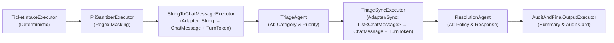

# Mixed Workflow: Agents and Custom Executors

This sample demonstrates how to seamlessly mix **deterministic custom executors** and **AI agents** within a unified pipeline using the Microsoft Agent Framework workflow engine.

## Overview

In real-world applications, enterprise workflows rarely consist solely of AI calls. They frequently combine:
- **Deterministic business logic**: Data validation, regex-based PII sanitization, database persistence, and audit logging.
- **AI-powered reasoning**: Intent triage, sentiment analysis, policy assessment, and personalized response generation.

This sample demonstrates how to bridge the gap between simple executor payloads (such as `string` or domain records) and the **Chat Protocol** required by AI agents.

---

## The Core Concept: The Adapter Pattern & The Chat Protocol

### 1. The Type Gap
Custom executors typically produce strongly typed domain objects or primitive types (`string`, `int`, custom records). Conversely, `AIAgent` workflow components operate on the **Chat Protocol**, expecting `ChatMessage` or `List<ChatMessage>`.

### 2. The Chat Protocol Requirements
Agents in Microsoft Agent Framework workflows require two conditions to execute:
1. **Accumulation**: They receive and accumulate `ChatMessage` instances (with roles like `ChatRole.User` or `ChatRole.Assistant`).
2. **Turn Triggering**: They only execute inference when they receive a `TurnToken` signal.

### 3. The Adapter's Role
An **Adapter Executor** (such as `StringToChatMessageExecutor` and `TriageSyncExecutor`) bridges this contract:
- Decorates itself with `[SendsMessage(typeof(ChatMessage))]` and `[SendsMessage(typeof(TurnToken))]`.
- Converts the upstream payload into a `ChatMessage`.
- Dispatches both the message and a `TurnToken` via `context.SendMessageAsync(...)`.

### 4. Agent Forwarding Behavior (`AIAgentHostOptions.ForwardIncomingMessages`)
By default, `AIAgentHostOptions.ForwardIncomingMessages` is `true`. This causes agents to forward both their **input messages** and their **newly generated response** downstream. In mixed pipelines with intermediate custom executors, this would cause downstream executors to be invoked twice (once with the raw input prompt and once with the generated output). To avoid duplication:
```csharp
AIAgentHostOptions options = new() { ForwardIncomingMessages = false };
ExecutorBinding agentExecutor = agent.BindAsExecutor(options);
```

---

## Architecture & Scenario: Enterprise Support & PII Sanitizer Pipeline



### Pipeline Stages

1. **`TicketIntakeExecutor`** *(Deterministic)*:
   - Receives the raw support ticket.
   - Generates a tracking ID (`TKT-XXXXX`).
   - Initializes a `TicketAuditRecord` in the shared workflow state scope.

2. **`PiiSanitizerExecutor`** *(Deterministic)*:
   - Runs compiled regex engines to detect and redact sensitive Personally Identifiable Information (Emails, Phone numbers, Credit cards, Account numbers).
   - Records redaction counts and categories into the shared state.
   - Yields the sanitized string.

3. **`StringToChatMessageExecutor`** *(Adapter: String &rarr; Chat Protocol)*:
   - Wraps the sanitized text into a `ChatMessage(ChatRole.User, text)`.
   - Emits a `TurnToken(emitEvents: true)` to trigger the downstream agent.

4. **`TriageAgent`** *(AI Agent)*:
   - Analyzes the sanitized ticket.
   - Outputs structured classifications: `CATEGORY`, `PRIORITY`, `SUMMARY`, and `POLICY_NOTE`.

5. **`TriageSyncExecutor`** *(Adapter & State Synchronizer: Chat Protocol &rarr; Chat Protocol)*:
   - Consumes `List<ChatMessage>` from the triage agent.
   - Parses triage metadata and stores it in the shared state.
   - Constructs an enriched, contextual prompt containing the ticket ID, triage classification, and sanitization metrics.
   - Dispatches a new `ChatMessage` and `TurnToken` to the resolution agent.

6. **`ResolutionAgent`** *(AI Agent)*:
   - Generates an empathetic, enterprise-compliant support response based on the triage notes and customer context without attempting to guess masked PII.

7. **`AuditAndFinalOutputExecutor`** *(Deterministic)*:
   - Consumes the final response from `ResolutionAgent`.
   - Reads the accumulated audit record from the workflow state.
   - Renders a formatted enterprise support audit card in the console.

---

## Shared Workflow State Management

Executors and agents operate independently. To share out-of-band telemetry (such as ticket IDs, redaction audit logs, and triage classifications), the sample uses **explicitly named workflow scopes**:

```csharp
// Updating shared state
await context.QueueStateUpdateAsync(
    WorkflowStateConstants.AuditKey, 
    auditRecord, 
    WorkflowStateConstants.ScopeName, 
    cancellationToken);

// Reading shared state in subsequent steps
TicketAuditRecord? audit = await context.ReadStateAsync<TicketAuditRecord>(
    WorkflowStateConstants.AuditKey, 
    WorkflowStateConstants.ScopeName, 
    cancellationToken);
```

---

## Prerequisites

1. Set up your repository root `.env` file or export your LLM credentials:
   - `AZURE_OPENAI_ENDPOINT`
   - `AZURE_OPENAI_DEPLOYMENT` or `OPENAI_MODEL`
   - Azure CLI login (`az login`) or OpenAI API Key.

---

## Running the Sample

Execute via the .NET CLI from the solution root:

```bash
dotnet run --project ./src/Orchestration.MixedWorkflowAgentsAndExecutors/Orchestration.MixedWorkflowAgentsAndExecutors.csproj
```

### Interaction Options:
- **Press Enter** with an empty prompt to run the built-in test suite:
  1. *Billing issue with credit card and email PII*.
  2. *Critical infrastructure outage with telephone numbers and ops email*.
  3. *General product inquiry with no PII*.
- **Enter a custom message** to process any user-supplied support ticket in real-time.
- Type `exit` to terminate the interactive loop.
