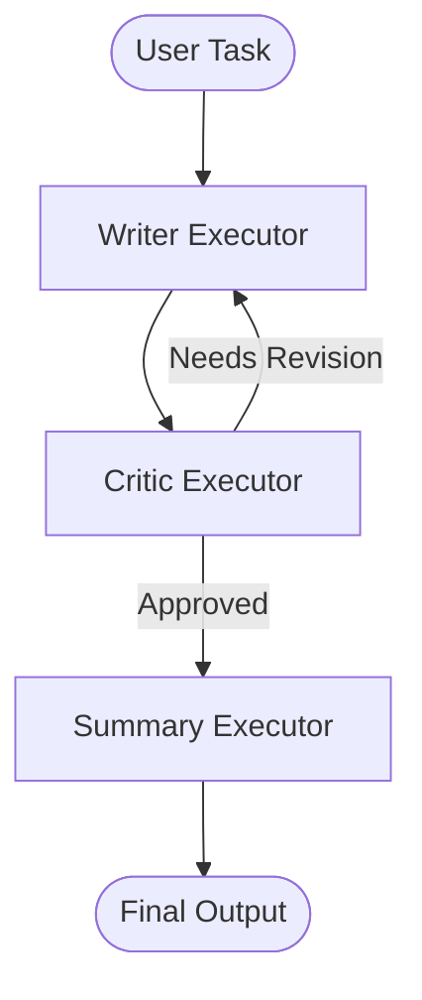

# Writer-Critic Iteration Workflow Sample

This sample demonstrates an iterative refinement workflow between **Writer** and **Critic** agents using Microsoft Agent Framework.

## Architecture

The workflow implements a cyclic content-creation and quality-review loop:

1. **Writer**: Creates the initial draft based on the user's task or revises draft content based on structured feedback.
2. **Critic**: Reviews the content and outputs a structured `CriticDecision` (`approved: true|false`, `feedback: "..."`).
   - If **Rejected**: Routes back to the `Writer` with feedback to iterate.
   - If **Approved** (or safety `MaxIterations` reached): Routes to `Summary`.
3. **Summary**: Presents the final polished approved content.



## Key Concepts Demonstrated

- **Iterative Refinement Loop**: Dynamic cycles with conditional edge routing (`AddSwitch`).
- **Structured Output**: Strong schema-enforced agent decision-making (`CriticDecision`) using `ChatResponseFormat.ForJsonSchema<T>()`.
- **Shared Workflow State**: Iteration counter and history tracking across workflow turns via `IWorkflowContext`.
- **Safety Cap**: Prevents unbounded loops via `MaxIterations` (default: 3, configurable via `MAX_ITERATIONS` environment variable).
- **Multiple Message Handlers**: `WriterExecutor` handles both initial user request strings and `CriticDecision` revision objects.
- **Real-Time Streaming**: Live streaming of generation updates during workflow execution.

## Prerequisites

Configure your Microsoft Foundry / Azure AI Project credentials in your repository-root `.env` file or environment variables:

- `FOUNDRY_PROJECT_ENDPOINT` (or `AZURE_AI_PROJECT_ENDPOINT`)
- `FOUNDRY_MODEL` (or `AZURE_AI_MODEL_DEPLOYMENT_NAME`, defaults to `gpt-5.4-mini`)
- `MAX_ITERATIONS` (optional, defaults to `3`)

Ensure you are authenticated with Azure (e.g., via `az login`).

## Running the Sample

Run with the default sample task:

```bash
dotnet run --project ./src/Orchestration.WriterCriticWorkflow/Orchestration.WriterCriticWorkflow.csproj
```

Or pass a custom prompt directly as command-line arguments:

```bash
dotnet run --project ./src/Orchestration.WriterCriticWorkflow/Orchestration.WriterCriticWorkflow.csproj -- "Write an announcement email for a new product launch in 100 words."
```
